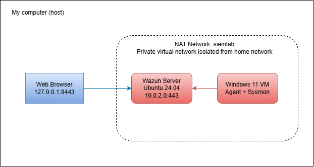

# Home SIEM Lab: Wazuh Detection in VirtualBox

> One sentence summary: A virtualized SIEM lab where I deployed Wazuh, collected Windows endpoint telemetry with Sysmon, simulated attacker techniques, and wrote custom detection rules mapped to MITRE ATT&CK.

**Status:** In progress  
**Last updated:** 2026-11-12

## Objectives
- Learn about log collection and detection rule writing
- Capture logs from Wazuh through Sysmon  

## Architecture



| Component | Role | Specs |
|---|---|---|
| Wazuh server VM | Manager, indexer, dashboard | Ubuntu Server 24.04, 4 vCPU, 8 GB RAM, 50 GB disk |
| Windows 11 VM | Monitored endpoint | Windows 11 Enterprise eval, 2 vCPU, 4 GB RAM, 60 GB disk |
| Network | Isolated VirtualBox NAT Network (`siemlab`) | Dashboard reached via host port forward 8443 -> 443 |

**Design decision:** I used a NAT Network as it allows the VMs to be on a private and isolated virtual network instead of using my home network. 

## Tools Used

- VirtualBox 7.2.22
- Wazuh 4.14.10 (all-in-one deployment)
- Sysmon + [config name/source]
- Atomic Red Team
- (Add anything else: Hydra, Wireshark, etc.)

## Setup Summary

Short version of what you did. Link to the detailed steps rather than pasting everything here.

1. Created the isolated network and VMs
2. Installed Wazuh server
3. Deployed and enrolled the Windows agent
4. Installed Sysmon and forwarded its logs to Wazuh
5. Took snapshots at each stable point

Full steps: [docs/setup.md](docs/setup.md)

## Attack Simulations and Detections

| # | Technique (MITRE ID) | How I simulated it | Detected by default? | Rule / Alert ID | Notes |
|---|---|---|---|---|---|
| 1 | Brute force (T1110) | Repeated failed logons | Yes / No | | |
| 2 | (Technique name, ID) | (Atomic test number or command) | | | |
| 3 | | | | | |

### Custom rules

Rules I wrote are in [`rules/local_rules.xml`](rules/local_rules.xml).

For each one, explain:
- What behavior it detects
- Which log source it relies on
- Why you wrote it (what the default rules missed)
- How you tested it

### Tuning

Describe any false positives you saw and what you changed to reduce them.

## Results

- Techniques tested: N
- Detected out of the box: N
- Detected after custom rules: N
- Still not detected: N (and why)


## Challenges and What I Learned

Be specific. Real problems you hit and how you solved them are the best part of the writeup.

- **Problem:** (e.g., agent showed "Never connected")
  **Cause:** (e.g., wrong manager IP in ossec.conf)
  **Fix:** (e.g., corrected the IP and restarted the service)
- **Problem:**
  **Cause:**
  **Fix:**

## Limitations and Next Steps

Honest gaps and what you would do with more time.

- (e.g., Only one endpoint, so no lateral movement scenarios)
- (e.g., Add a Linux agent and test SSH brute force)
- (e.g., Integrate a threat intel feed)
- (e.g., Try Wazuh active response to block repeated failed logins)

## Repository Layout

```
.
├── README.md
├── docs/
│   ├── setup.md
├── rules/
│   └── local_rules.xml
├── tests/
│   └── atomic-tests.md
└── screenshots/
```

## Safety Note

All attack simulations were run only inside isolated virtual machines that I own. No credentials or personal data are stored in this repository.
