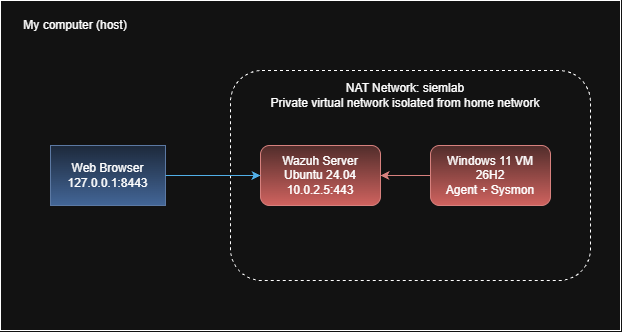

# Home SIEM Lab: Wazuh Detection in VirtualBox

> A virtualized SIEM lab where I deployed Wazuh, collected Windows endpoint telemetry with Sysmon, simulated attacker techniques, and wrote custom detection rules mapped to MITRE ATT&CK techniques.

## Objectives
- Practice collecting and analyzing logs in a SIEM
- Write and test custom detection rules against simulated attacker techniques
- Capture Sysmon logs by forwarding them to Wazuh  

## Architecture



| Component | Role | Specs |
|---|---|---|
| Wazuh server VM | Manager, indexer, dashboard | Ubuntu Server 24.04, 4 vCPU, 8 GB RAM, 50 GB disk |
| Windows 11 VM | Monitored endpoint | Windows 11 Enterprise, 2 vCPU, 4 GB RAM, 60 GB disk |
| Network | Isolated VirtualBox NAT Network (`siemlab`) | Dashboard reached via host port forward 8443 -> 443 |

**Design decision:** I used a NAT Network because it isolates my VMs from my home network, using the host computer as a virtual router. This gives mores security/safety to my home network and prevents my network from making connections to the VMs and vice versa besides forwarded ports.

## Tools Used

- VirtualBox 7.2.22
- Ubuntu Server 24.04 ISO
- Windows 11 Enterprise 26H2 ISO 
- Wazuh 4.14.10 (all-in-one deployment)
- Sysmon 15.22 + SwiftOnSecurity Config
- Atomic Red Team

**Design decision:** I used the SwiftOnSecurity Sysmon config rather than Sysmon out of the box as it is well documented and readable. It focuses on logging events worth analyzing (file creation, process creation, DNS queries, etc.) while filtering out noise that would otherwise flood the logs.

## Setup Summary

1. Created the isolated network and VMs
2. Installed Wazuh server
3. Deployed and enrolled the Windows agent
4. Installed Sysmon and forwarded its logs to Wazuh
5. Took snapshots at each stable point

Full steps: [docs/setup.md](docs/setup.md)

## Attack Simulations and Detections
Attack simulations are documented at: [tests/atomic-tests.md](tests/atomic-tests.md)

## Custom Detection Rules
Any custom rules written are in: [rules/custom-rules.md](rules/custom-rules.md)

## Results
- Techniques tested: 7
- Detected out of the box: 6
- Detected after custom rules: 1

## Challenges and What I Learned
> Some issues I faced were also documented in [docs/setup.md#8-troubleshooting-log](https://github.com/apham728/home-siem-lab/blob/main/docs/setup.md#8-troubleshooting-log)
- **Problem:** Wazuh's default rules alerted on my T1016 test, but none of the alerts were tagged T1016.  
  - **Cause:** The default rules flagged the cmd shell and generic discovery behavior (tagged T1087 and T1059.003), so the alerts didn't point towards the idea that someone was mapping the network.  
  - **Fix:** I wrote a base rule plus a correlation rule that sends an alert when several discovery tools run from the same parent process within 30 seconds.  
  - **Lesson:** An alert being sent isn't equal to a negative behavior being detected. Whether the alert identifies the right behavior clearly matters as much as whether it goes off or not.

- **Problem:** My correlation rule stopped firing when I added a "different tool" condition.  
  - **Cause:** Testing each condition separately showed that `<same_field>` worked and `<different_field>` made rule 100031 stop firing.  
  - **Fix:** I removed `<different_field>` from rule 100031. The rule now counts matches from the same parent, although, without checking that the tools differ.  
  - **Lesson:** Perform trial and error by adding rule conditions one at a time and testing after each to isolate and figure out which condition broke the rule.
  
- **Problem:** Alerts that looked like attacker activity were actually just the Wazuh agent's own scans.
  - **Cause:** The agent would run commands such as `secedit` and `net user`. The `parentImage` being `wazuh-agent.exe`, the SYSTEM integrity level, and the agent's working directory showed where they came from.
  - **Fix:** Identified them by expanding the logs and analyzing the origins of the log. I didn't suppress the logs left by the agent's activity and I plan to add an exception to filter them out in the future.
  - **Lesson:** The same command can be harmless or malicious, it is important to check the facts of the log like the parent process to decide the nature of the event.

## Limitations

- The custom detection rules for T1016 can false positive. It has tradeoffs in that it is able to send a specific alert when different network discovery tools are used but it can also send a false alert when repeating the usage of the same tool. The common routine of using these tools can also trigger it. (more details in [rules/custom-rules.md](https://github.com/apham728/home-siem-lab/blob/main/rules/custom-rules.md))
- This lab did its test in a clean environment. I don't know how my rules would behave in a real environment as this lab was mainly done for learning purposes.
- The fact that testing was done on a singular Windows 11 VM with a singular Sysmon config means that my detection rate will vary across other platforms and/or other configs.
- Perform more Atomic tests to further analyze how Sysmon and Wazuh view and log different behaviors

## Next Steps
- Write additional custom detection rules to understand more on how Wazuh detects and fires alerts
- Add an exception for the Wazuh agent's own scans to cut noise in the logs
- Perhaps add another VM (most likely Linux) as an extra agent and look at how I can test the logging system on a different platform

## Repository Layout

```
.
├── README.md
├── docs/
│   ├── setup.md
├── rules/
│   └── custom-rules.md
├── tests/
│   └── atomic-tests.md
└── screenshots/
```
