Step by step record of how I built the lab.  

## Host Machine Minimum Requirements
> 16GB RAM, 120GB free storage, 4 CPU cores. This lab was done on a 16 core, 32GB RAM, and Windows 11 host system.

---

## 1. Prerequisites
> Note: Files for Sysmon and its config are listed but downloading them is unnecessary

| Item | Version | Source |
|---|---|---|
| VirtualBox | 7.2.22 | [https://virtualbox.org/wiki/Downloads](https://www.virtualbox.org/wiki/Downloads) |
| Ubuntu Server ISO | 24.04 LTS (live-server, amd64) | [releases.ubuntu.com/24.04/](https://releases.ubuntu.com/24.04/) |
| Windows 11 Enterprise evaluation ISO | 26H2 | [Microsoft Evaluation Center](https://info.microsoft.com/ww-landing-windows-11-enterprise.html) |
| Sysmon | 15.22 | [Microsoft Sysinternals](https://learn.microsoft.com/en-us/sysinternals/downloads/sysmon) |
| Sysmon config | SwiftOnSecurity | [GitHub](https://github.com/SwiftOnSecurity/sysmon-config/blob/master/sysmonconfig-export.xml) |

## 2. Network setup

1. VirtualBox > File > Tools > Network > NAT Networks > Create
2. Name: `siemlab`, range: `10.0.2.0/24`, DHCP enabled
3. Click on Port Forwarding tab
4. Create new port forwarding rule on IPv4: Host `127.0.0.1:8443` -> Wazuh server `:443` (Guest Port)

5. Apply

## 3. Wazuh server VM

| Setting | Value |
|---|---|
| OS | Ubuntu Server 24.04 LTS |
| vCPUs | 4 |
| RAM | 8 GB |
| Disk | 50 GB |
| Network | NAT Network `siemlab` |
| IP address | 10.0.2.5 |

1. VirtualBox > Machine > New
2. Name: `Wazuh Server`
3. Set ISO Image to the Ubuntu Live Server ISO
4. Uncheck `Proceed with Unattended Installation`
5. Ensure VM settings look like the following screenshots:


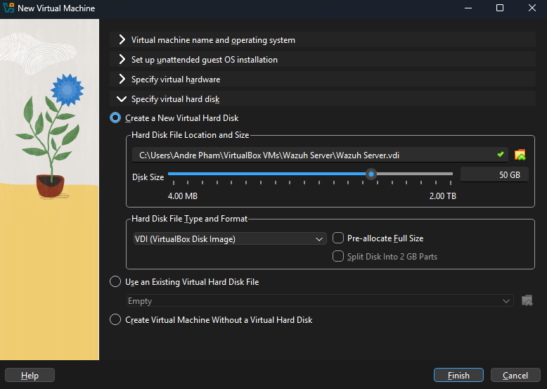
6. Click Finish
7. Open settings for newly made Wazuh Server VM
8. Network > Adapter 1 > Attached to: NAT Network
9. Select `siemlab`  

10. Click Ok
11. Run the VM by double clicking on it
12. Ensure you see a screen similar to below and press Enter
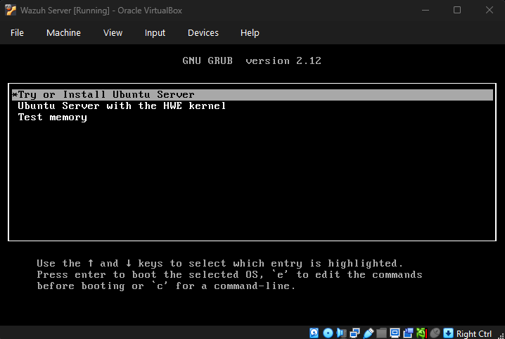
13. Use UP and DOWN arrow keys to navigate the languages and Enter to select (I chose English)
14. Press Enter again (Continue without updating)
15. Select your keyboard layout and press Enter on Done
16. Continue selecting Done until you reach this screen and then select Continue
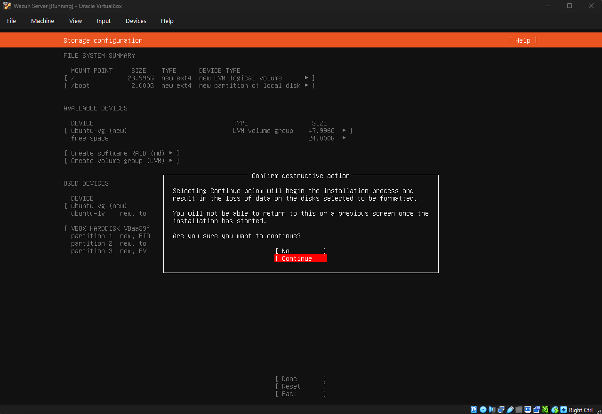
17. Set the profile as the following (use a password you will remember) and select Done
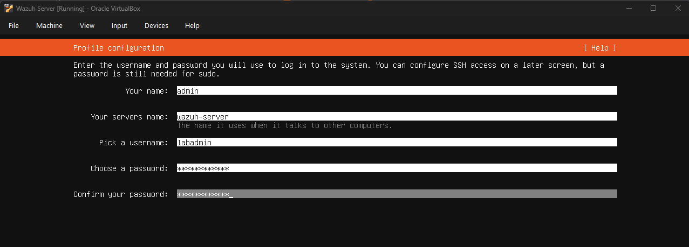
18. Skip upgrading to Ubuntu Pro and continue
19. Press Enter to enable Install OpenSSH Server and continue
20. Don't select any featured server snaps and continue
21. Wait for the system to finish installing
22. Once complete, select Reboot Now
23. If a message appears saying to remove installation medium, press Enter
24. After the reboot, log in by entering your username, **labadmin**, first and then your password
25. Find out the server's IP address by entering `ip a`

26. Update the port forwarding rule in the `siemlab` NAT Network and change the Guest IP to the address found by `ip a`
27. Make sure to apply the change
28. Take a snapshot of the VM in case anything messes up later: Machine > Take Snapshot
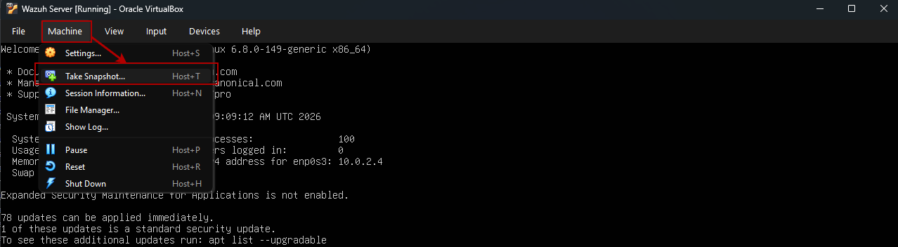
29. Enter the snapshot name as `ubuntu fresh install`

### Install Wazuh
1. Go to `siemlab` in NAT Networks and add a port forwarding rule as follows: Name `ssh` -> Host `127.0.0.1:2222` -> Guest `VM's Address (10.0.2.x):22`
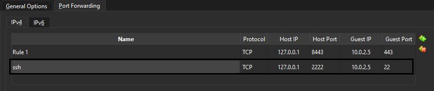
2. Open PowerShell and run:
```powershell
ssh -p 2222 labadmin@127.0.0.1
```
3. Enter `yes` and then enter the password for Wazuh Server
4. Check [https://documentation.wazuh.com/current/quickstart.html](https://documentation.wazuh.com/current/quickstart.html) for the latest installer command and run the command (I used version 4.14) 
   
```bash
curl -sO https://packages.wazuh.com/4.14/wazuh-install.sh && sudo bash ./wazuh-install.sh -a
```

5. Access dashboard at `https://127.0.0.1:8443` (accept the self-signed certificate warning; Advanced > Proceed)
6. Log in using the credentials given after installing Wazuh in PowerShell
> List credentials by running `sudo tar -O -xvf wazuh-install-files.tar wazuh-install-files/wazuh-passwords.txt`

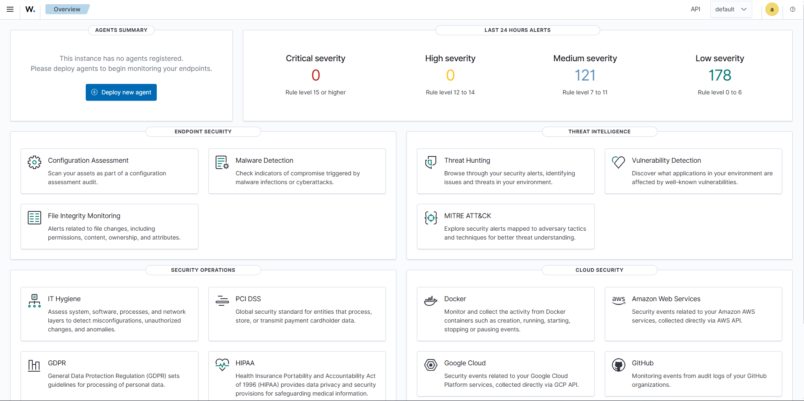

7. Take a snapshot of the VM after successfully installing Wazuh: Machine > Take Snapshot
8. Enter the snapshot name as `wazuh server install`

## 4. Windows VM

| Setting | Value |
|---|---|
| OS | Windows 11 Enterprise |
| vCPUs | 2 |
| RAM | 4 GB |
| Disk | 60 GB |
| Network | NAT Network `siemlab` |
| Local account | Offline account (no Microsoft account) |

1. VirtualBox > Machine > New
2. Name: `Windows 11`
3. Set ISO Image to the Windows 11 ISO
4. Ensure VM settings look like the following screenshots:

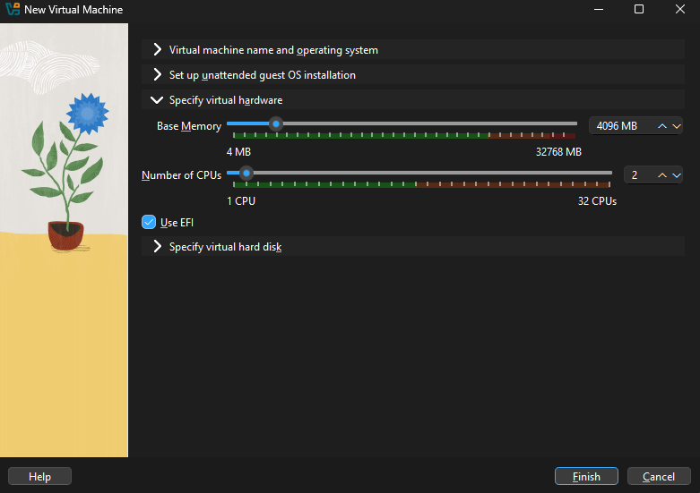

5. Click Finish
6. Open settings for Windows 11 VM
7. Network > Adapter 1 > Attached to: NAT Network
8. Select `siemlab`
9. System > TPM Version > 2.0
10. Click Ok
11. Run the VM by double clicking on it
12. Go through the installation for Windows 11 until you reach the sign in screen
13. Create an offline account for the VM  
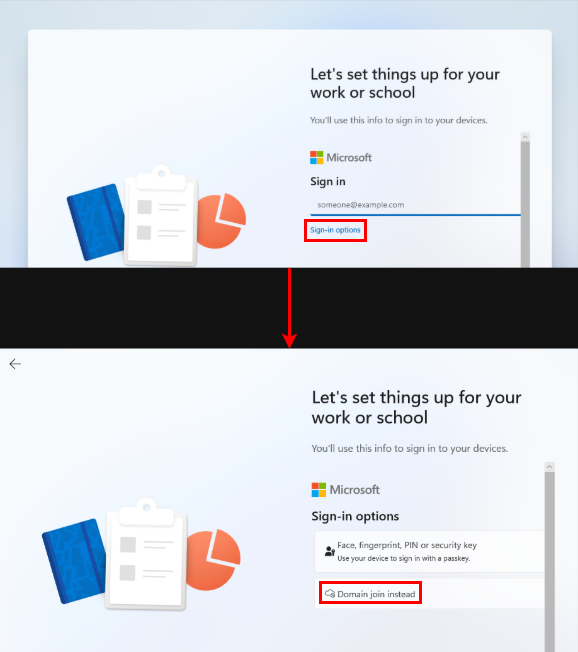
14. Choose your username and password credentials and set your security questions
16. Select "Update later" and continue letting Windows install
17. Install VirtualBox Guest Additions   
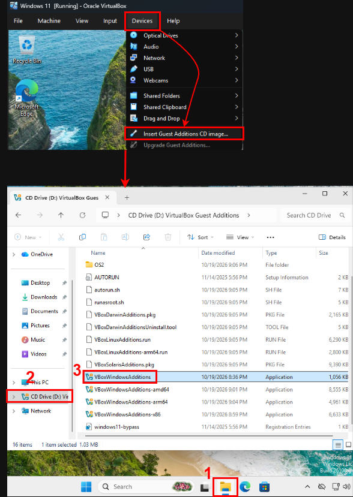
18. Choose "Reboot Now" after installing Guest Additions
19. After rebooting, go Devices > Shared Clipboard > Bidirectional (Allows copy and paste between host and VM)
20. Take snapshot of VM: Machine > Take Snapshot
21. Name: `win11 clean install`
22. Open back up the VirtualBox Manager, run the Wazuh Server VM, and allow a few minutes for the Wazuh indexer, manager, and dashboard to begin running
23. Open PowerShell on your Windows 11 VM and test your connection to Wazuh by running:
   ```powershell
   Test-NetConnection [server IP] -Port 1515
   ```
24. Ensure you see that the test passed  


## 5. Connect the Wazuh agent

1. Wazuh Dashboard > Deploy new agent
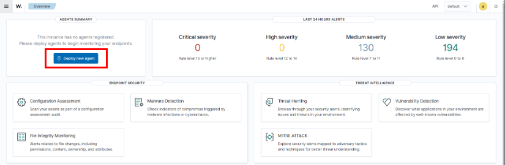
2. Select Windows as the package, enter the server's IP `10.0.2.x` , enter the agent name `win11-lab`
3. Copy and run the given command inside of Administrator PowerShell  

5. Start the service:
   ```powershell
   NET START WazuhSvc
   ```
6. Around a minute after starting the service, confirm the agent is **Active** in the agent list  
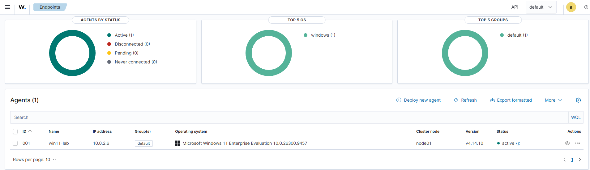
7. Take snapshot of VM: Machine > Take Snapshot
8. Name: `win11 agent install`

## 6. Sysmon
> In Windows 11 VM
1. Install Sysmon with the SwiftOnSecurity config by running the following in Administrator PowerShell:
> Note: All future commands will be done in Admin Powershell  
   ```powershell
   mkdir C:\Sysmon
   cd C:\Sysmon
   Invoke-WebRequest -Uri https://download.sysinternals.com/files/Sysmon.zip -OutFile Sysmon.zip
   Expand-Archive Sysmon.zip -DestinationPath . -Force
   Invoke-WebRequest -Uri https://raw.githubusercontent.com/SwiftOnSecurity/sysmon-config/master/sysmonconfig-export.xml -OutFile sysmonconfig-export.xml
   .\Sysmon64.exe -accepteula -i sysmonconfig-export.xml
   ```
2. Tell the Wazuh agent to collect Sysmon logs
   1. Run the command in PowerShell:  
   ```powershell
   notepad "C:\Program Files (x86)\ossec-agent\ossec.conf"
   ```
   2. Find the last `</ossec_config>` near the bottom and paste the following just above it:
   ```xml
   <localfile>
   <location>Microsoft-Windows-Sysmon/Operational</location>
   <log_format>eventchannel</log_format>
   </localfile>
   ```
   3. Press `Ctrl + S` to save the updated file
3. Restart the agent in PowerShell by running:
   ```powershell
   Restart-Service -Name wazuh
   ```
4. Generate test activity in the VM by running the following in PowerShell:
   ```powershell
   cmd.exe /c whoami
   ```
5. Verify the event
   1. In the dashboard, go to Threat Hunting > Events, make sure the `win11-lab` agent is selected, search for `sysmon`
   2. Look for a log entry that reads `Suspicious Windows cmd shell execution`
   3. Expand the log and confirm the fields `data.win.eventdata.commandLine:` whoami, `data.win.eventdata.image:` C:\\Windows\\System32\\whoami.exe, `data.win.eventdata.user:` DESKTOP-...\\admin  
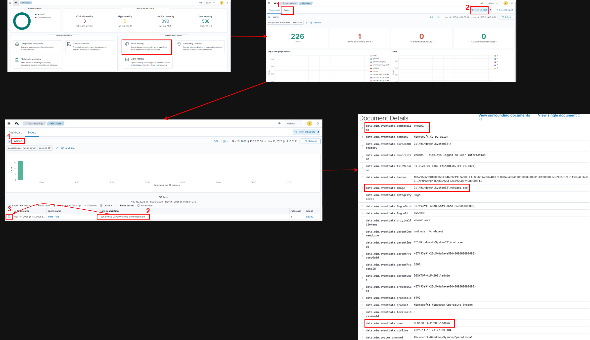
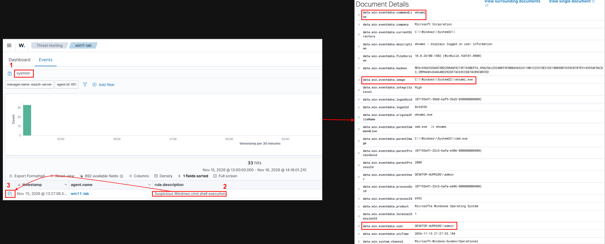
6. Take snapshot of VM: Machine > Take Snapshot
7. Name: `win11 sysmon`

## 7. Verification

Generated test activity and confirmed it appeared in the dashboard:
> Documentation for other Sysmon events can be found at [https://learn.microsoft.com/en-us/windows/security/operating-system-security/sysmon/sysmon-events](https://learn.microsoft.com/en-us/windows/security/operating-system-security/sysmon/sysmon-events)

| Action on Windows VM | Expected result | Seen in Wazuh? |
|---|---|---|
| `cmd.exe /c whoami` | Sysmon logs process creation event (Event ID 1) and Wazuh shows alert for `whoami` | [Yes, log gave commandLine `whoami.exe`, ran by user `DESKTOP-...\\admin`](../screenshots/25-test1-seen-in-wazuh.png) |
| `New-Item -Path "$env:USERPROFILE\Desktop\test.exe" -ItemType File` | Sysmon logs file creation event (Event ID 11) and Wazuh shows a log for `test.exe`  | [Yes, log gave targetFilename `C:\\Users\\admin\\Desktop\\test.exe`, ran by user `DESKTOP-...\\admin`](../screenshots/26-test2-seen-in-wazuh.png) |


## 8. Troubleshooting log

| Problem | Cause | Fix |
|---|---|---|
| ["Failed to save the settings of the virtual machine" (VERR_PATH_NOT_FOUND)](../screenshots/troubleshooting-path-not-found.png) | [Folder for VM was missing](../screenshots/troubleshooting-path-not-found-cause.png) | [Removed VM from VirtualBox and recreated it, properly creating the folder now](../screenshots/troubleshooting-path-not-found-fix.png) |
| [Wazuh dashboard installation failed and rolled back](../screenshots/troubleshoot-dashboard-install-fail.png)| [Ubuntu only gave 24GB to the system with another 24GB unallocated, causing Wazuh dashboard installation to run out of space while extracting](../screenshots/troubleshoot-dashboard-install-fail-cause.png) | [Ran `sudo lvextend -r -l +100%FREE /dev/ubuntu-vg/ubuntu-lv` to extend system space and then reran installer](../screenshots/troubleshoot-dashboard-install-fail-fix.png) |
| [Windows 11 VM got stuck on a black screen/loaded very slow](../screenshots/troubleshoot-w11-black-screen.png) | [Windows virtualization based security (Memory Integrity) was enabled, making Windows take main control of CPU virtualization features and causing VirtualBox to fall back onto a slower path](../screenshots/troubleshoot-w11-black-screen-cause.png) | [Disabled Memory Integrity by setting `Enabled` to `0` in Registry Editor at the registry key below and restarted host](../screenshots/troubleshoot-w11-black-screen-fix.png) |

- Registry Key Path
  - ```HKLM\SYSTEM\CurrentControlSet\Control\DeviceGuard\Scenarios\HypervisorEnforcedCodeIntegrity```
  - **Note:** Set `Enabled` back to `1` after the lab

## 9. Snapshots

| Snapshot | VM | State |
|---|---|---|
| `ubuntu fresh install` | Wazuh Server | Fresh install of Ubuntu |
| `wazuh server install` | Wazuh Server | Fresh install of Wazuh with dashboard working |
| `win11 clean install` | Windows 11 | Fresh install of Windows 11 |
| `win11 agent install` | Windows 11 | Windows 11 after deploying Wazuh agent |
| `win11 sysmon` | Windows 11 | Windows 11 after verifying Sysmon works |

## 10. Next steps

See the main [README](../README.md) for attack simulations, custom rules, and results.
