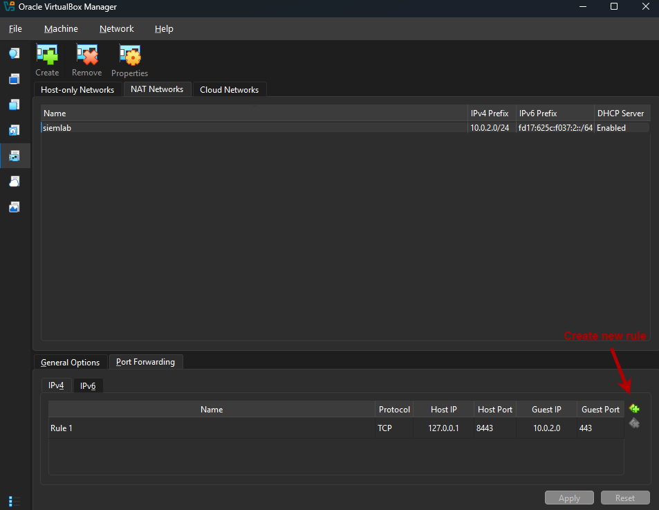
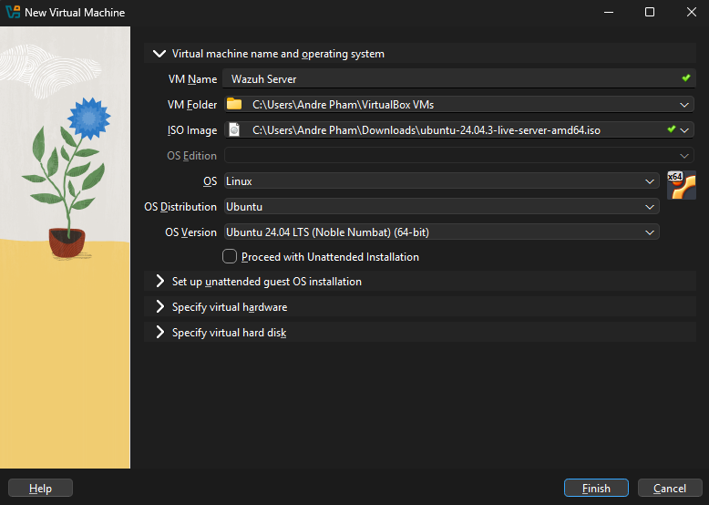
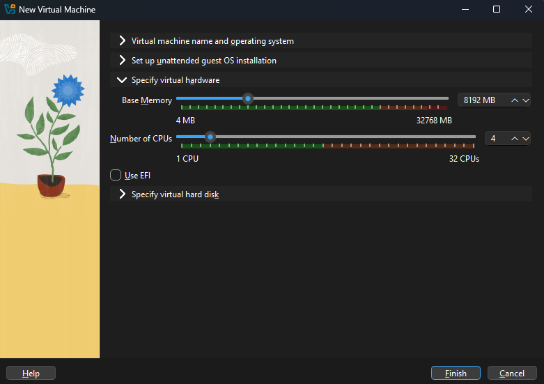
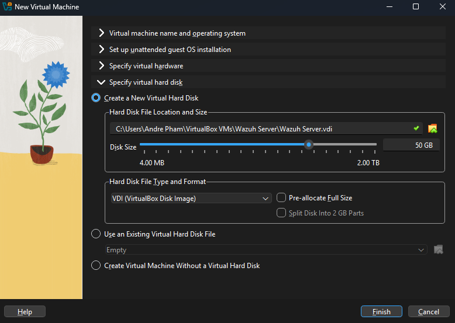
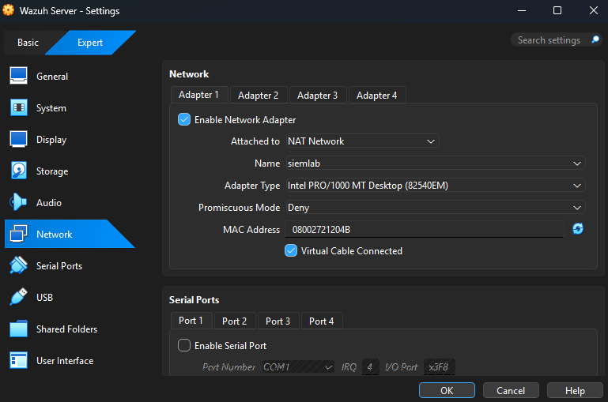

# Setup Guide

Step-by-step record of how I built the lab.

**Host machine:** Intel i9-12900k, 32 GB RAM, Windows 11  
**Date built:** 11-12-2026

---

## 1. Prerequisites

| Item | Version | Source |
|---|---|---|
| VirtualBox + Extension Pack | 7.2.22 | [https://virtualbox.org/wiki/Downloads](https://www.virtualbox.org/wiki/Downloads) |
| Ubuntu Server ISO | 24.04 LTS (live-server, amd64) | [releases.ubuntu.com/24.04/](https://releases.ubuntu.com/24.04/) |
| Windows 11 Enterprise evaluation ISO | 26H2 | Microsoft Evaluation Center |
| Sysmon | [version] | Microsoft Sysinternals |
| Sysmon config | [name, e.g. SwiftOnSecurity] | GitHub |

## 2. Network setup

1. VirtualBox > File > Tools > Network > NAT Networks > Create
2. Name: `siemlab`, range: `10.0.2.0/24`, DHCP enabled
3. Click on Port Forwarding tab
4. Create new port forwarding rule on IPv4: Host `127.0.0.1:8443` -> Wazuh server `10.0.2.0:443` (Guest Port)
5. Apply



**Why this design:** I used a VirtualBox NAT Network so the lab VMs are isolated from my home network while I run attack simulations later.

## 3. Wazuh server VM

| Setting | Value |
|---|---|
| OS | Ubuntu Server 24.04 LTS |
| vCPUs | 4 |
| RAM | 8 GB |
| Disk | 50 GB |
| Network | NAT Network `siemlab` |
| IP address | 10.0.2.4 |

1. VirtualBox > Machine > New
2. Name: `Wazuh Server`
3. Set ISO Image to the Ubuntu Live Server ISO
4. Ensure VM settings look like the following screenshots:



5. Click Finish
6. Open settings for newly made Wazuh Server VM
7. Network > Adapter 1 > Attached to: NAT Network
8. Select `siemlab`  

9. Click Ok


### Install Wazuh

```bash
curl -sO https://packages.wazuh.com/4.14/wazuh-install.sh && sudo bash ./wazuh-install.sh -a
```

> Version numbers change. Check documentation.wazuh.com/current/quickstart.html for the current command. Version I used: [x.y.z]

- Install time: [e.g. about 15 minutes]
- Retrieved credentials with:
  ```bash
  sudo tar -O -xvf wazuh-install-files.tar wazuh-install-files/wazuh-passwords.txt
  ```
- Accessed dashboard at `https://127.0.0.1:8443` (accepted the self-signed certificate warning)

📷 `screenshots/02-dashboard-first-login.png`

**Snapshot taken:** `wazuh-server-clean`

## 4. Windows VM

| Setting | Value |
|---|---|
| OS | Windows 11 Enterprise (evaluation) |
| vCPUs | 2 |
| RAM | 4 GB |
| Disk | 60 GB |
| Network | NAT Network `siemlab` |
| Local account | Throwaway lab account (no Microsoft account) |

Steps:
1. Enabled EFI and TPM 2.0 in VM settings
2. Installed Windows from ISO
3. Installed VirtualBox Guest Additions
4. Verified connectivity to the server:
   ```powershell
   Test-NetConnection [server IP] -Port 1515
   ```

**Snapshot taken:** `win11-clean-install`

## 5. Connect the Wazuh agent

1. Dashboard > Endpoints > Deploy new agent
2. Selected Windows, entered the server's internal IP, named the agent `win11-lab`
3. Ran the generated command in an Administrator PowerShell
4. Started the service:
   ```powershell
   NET START WazuhSvc
   ```
5. Confirmed the agent shows **Active** in the dashboard

📷 `screenshots/03-agent-active.png`

## 6. Sysmon

1. Installed Sysmon with the [config name] configuration:
   ```powershell
   .\Sysmon64.exe -accepteula -i [config file].xml
   ```
2. Added this block to `C:\Program Files (x86)\ossec-agent\ossec.conf`:
   ```xml
   <localfile>
     <location>Microsoft-Windows-Sysmon/Operational</location>
     <log_format>eventchannel</log_format>
   </localfile>
   ```
3. Restarted the agent:
   ```powershell
   Restart-Service -Name wazuh
   ```

📷 `screenshots/04-sysmon-events.png`

**Snapshot taken:** `win11-agent-sysmon`

## 7. Verification

Generated test activity and confirmed it appeared in the dashboard:

| Action on Windows VM | Expected result | Seen in Wazuh? |
|---|---|---|
| Ran `whoami` and `Get-Process` | Sysmon process-creation events | [Yes/No] |
| Failed logins at lock screen | Failed logon alerts | [Yes/No] |
| [your own test] | | |

## 8. Troubleshooting log

Add an entry every time something breaks. This section is one of the most valuable parts of the project.

| Problem | Cause | Fix |
|---|---|---|
| ["Failed to save the settings of the virtual machine" (VERR_PATH_NOT_FOUND)](../screenshots/troubleshooting-path-not-found.png) | [Folder for VM was missing](../screenshots/troubleshooting-path-not-found-cause.png) | Removed VM from VirtualBox and recreated it |
| | | |

## 9. Snapshots

| Snapshot | VM | State |
|---|---|---|
| `wazuh-server-clean` | Wazuh server | Fresh install, dashboard working |
| `win11-clean-install` | Windows 11 | Before agent or Sysmon |
| `win11-agent-sysmon` | Windows 11 | Agent and Sysmon configured |

Roll back to `win11-agent-sysmon` after each round of attack simulations.

## 10. Next steps

See the main [README](../README.md) for attack simulations, custom rules, and results.
