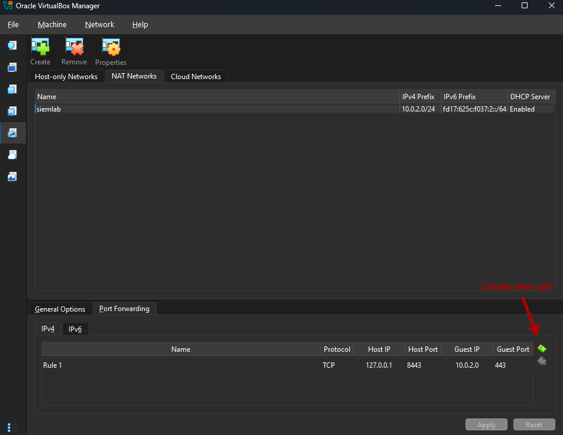
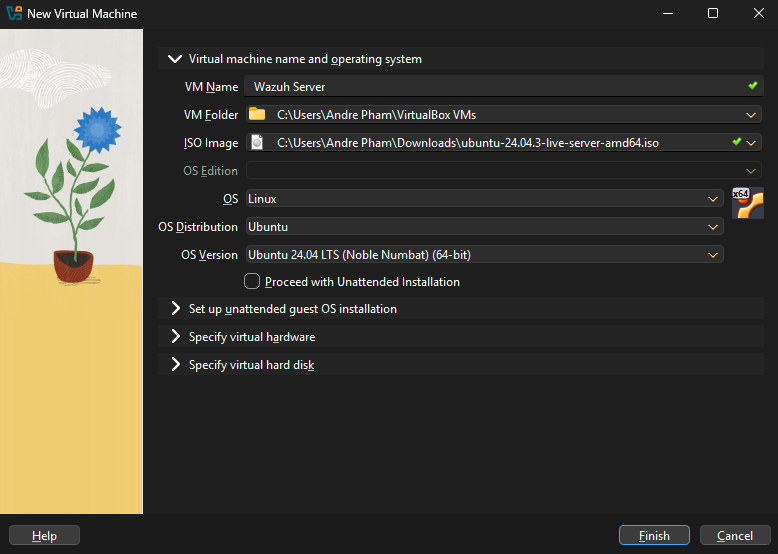
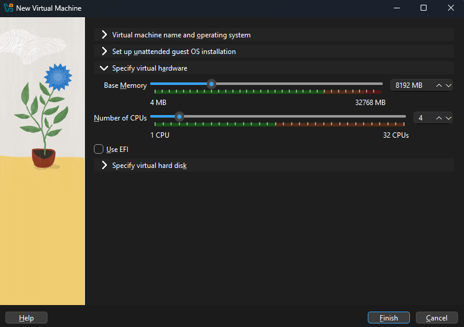
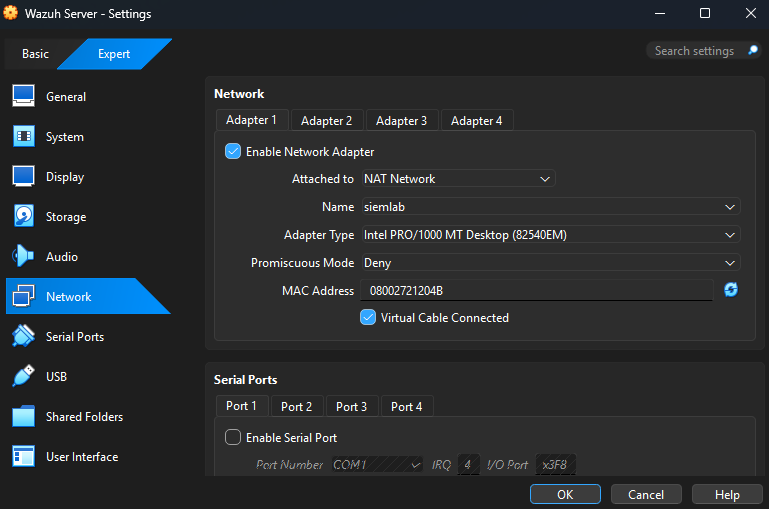
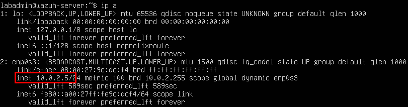
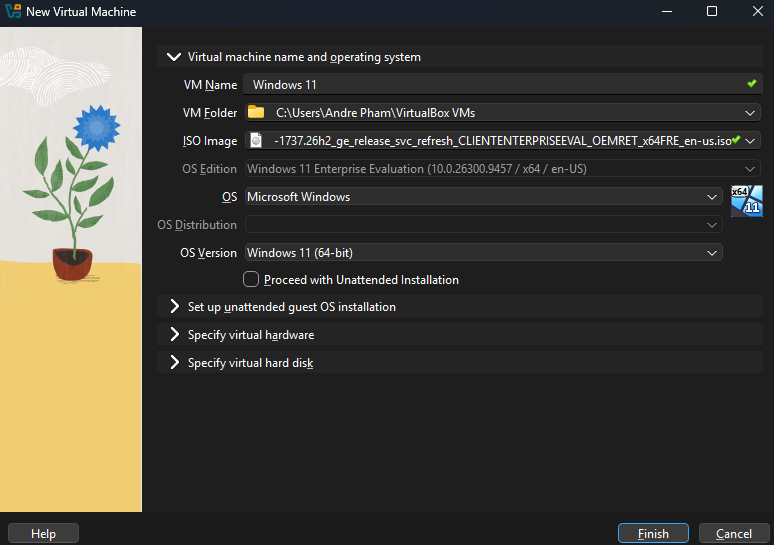
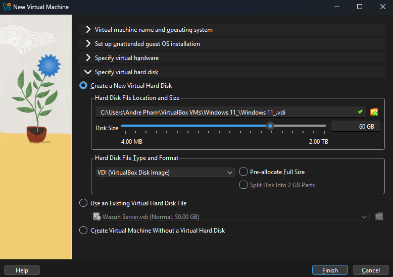
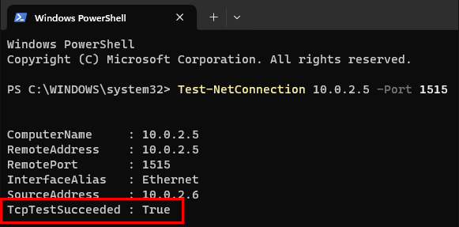
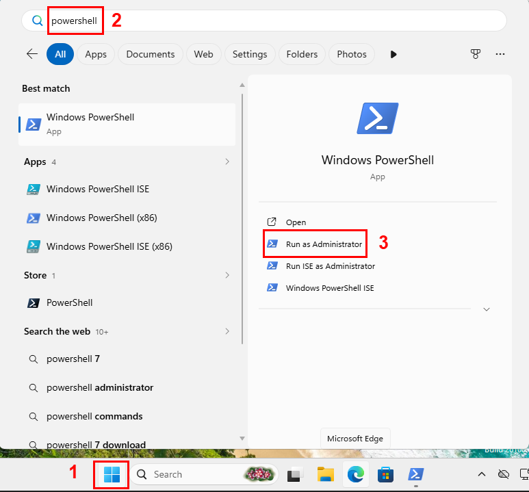

Step by step record of how I built the lab.  
**Date built:** 11-12-2026

## Host Machine Minimum Requirements
> 16GB RAM, 120GB free storage, 4 CPU cores. This lab was done on a 16 core, 32GB RAM, and Windows 11 host system.

---

## 1. Prerequisites

| Item | Version | Source |
|---|---|---|
| VirtualBox | 7.2.22 | [https://virtualbox.org/wiki/Downloads](https://www.virtualbox.org/wiki/Downloads) |
| Ubuntu Server ISO | 24.04 LTS (live-server, amd64) | [releases.ubuntu.com/24.04/](https://releases.ubuntu.com/24.04/) |
| Windows 11 Enterprise evaluation ISO | 26H2 | [Microsoft Evaluation Center](https://info.microsoft.com/ww-landing-windows-11-enterprise.html) |
| Sysmon | [version] | Microsoft Sysinternals |
| Sysmon config | [name, e.g. SwiftOnSecurity] | GitHub |

## 2. Network setup

1. VirtualBox > File > Tools > Network > NAT Networks > Create
2. Name: `siemlab`, range: `10.0.2.0/24`, DHCP enabled
3. Click on Port Forwarding tab
4. Create new port forwarding rule on IPv4: Host `127.0.0.1:8443` -> Wazuh server `:443` (Guest Port)

5. Apply

**Why this design:** I used a VirtualBox NAT Network so the lab VMs are isolated from my home network while I run attack simulations later.

## 3. Wazuh server VM

| Setting | Value |
|---|---|
| OS | Ubuntu Server 24.04 LTS |
| vCPUs | 4 |
| RAM | 8 GB |
| Disk | 50 GB |
| Network | NAT Network `siemlab` |
| IP address | 10.0.2.4 |

1. VirtualBox > Machine > New
2. Name: `Wazuh Server`
3. Set ISO Image to the Ubuntu Live Server ISO
4. Ensure VM settings look like the following screenshots:



5. Click Finish
6. Open settings for newly made Wazuh Server VM
7. Network > Adapter 1 > Attached to: NAT Network
8. Select `siemlab`  

9. Click Ok
10. Run the VM by double clicking on it
11. Ensure you see a screen similar to below and press Enter

12. Use UP and DOWN arrow keys to navigate the languages and Enter to select (I chose English)
13. Press Enter again (Continue without updating)
14. Select your keyboard layout and press Enter on Done
15. Continue selecting Done until you reach this screen and then select Continue

16. Set the profile as the following (use a password you will remember) and select Done

17. Skip upgrading to Ubuntu Pro and continue
18. Press Enter to enable Install OpenSSH Server and continue
19. Don't select any featured server snaps and continue
20. Wait for the system to finish installing
21. Once complete, select Reboot Now
22. If a message appears saying to remove installation medium, press Enter
23. After the reboot, log in by entering your username, **labadmin**, first and then your password
24. Find out the server's IP address by entering `ip a`

25. Update the port forwarding rule in the `siemlab` NAT Network and change the Guest IP to the address found by `ip a`
26. Make sure to apply the change
27. Take a snapshot of the VM in case anything messes up later: Machine > Take Snapshot

28. Enter the snapshot name as `ubuntu fresh install`

### Install Wazuh
1. Go to `siemlab` in NAT Networks and add a port forwarding rule as follows: Name `ssh` -> Host `127.0.0.1:2222` -> Guest `VM's Address (10.0.2.x):22`

2. Open PowerShell and run:
```powershell
ssh -p 2222 labadmin@127.0.0.1
```
3. Enter `yes` and then enter the password for Wazuh Server
4. Check [documentation.wazuh.com/current/quickstart.html](documentation.wazuh.com/current/quickstart.html) for the latest installer command and run the command (I used version 4.14) 
   
```bash
curl -sO https://packages.wazuh.com/4.14/wazuh-install.sh && sudo bash ./wazuh-install.sh -a
```

- Install time: ~15 minutes
5. Access dashboard at `https://127.0.0.1:8443` (accept the self-signed certificate warning; Advanced > Proceed)
6. Log in using the credentials given after installing Wazuh in PowerShell (!! note down your credentials in case you forget !!)


7. Take a snapshot of the VM after successfully installing Wazuh: Machine > Take Snapshot
8. Enter the snapshot name as `wazuh server install`

## 4. Windows VM

| Setting | Value |
|---|---|
| OS | Windows 11 Enterprise |
| vCPUs | 2 |
| RAM | 4 GB |
| Disk | 60 GB |
| Network | NAT Network `siemlab` |
| Local account | Offline account (no Microsoft account) |

1. VirtualBox > Machine > New
2. Name: `Windows 11`
3. Set ISO Image to the Windows 11 ISO
4. Ensure VM settings look like the following screenshots:



5. Click Finish
6. Open settings for newly made Wazuh Server VM
7. Network > Adapter 1 > Attached to: NAT Network
8. Select `siemlab`
9. System > TPM Version > 2.0
10. Click Ok
11. Run the VM by double clicking on it
12. Go through the installation for Windows 11 until you reach the sign in screen
13. Create an offline account for the VM  

14. Choose your username and password credentials and set your security questions
16. Select "Update later" and continue letting Windows install
17. Install VirtualBox Guest Additions   

18. Choose "Reboot Now" after installing Guest Additions
19. After rebooting, go Devices > Shared Clipboard > Bidirectional (Allows copy and paste between host and VM)
20. Take snapshot of VM: Machine > Take Snapshot
21. Name: `win11 clean install`
22. Open back up the VirtualBox Manager, run the Wazuh Server VM, and allow a few minutes for the Wazuh indexer, manager, and dashboard to begin running
23. Open PowerShell on your Windows 11 VM and test your connection to Wazuh by running:
   ```powershell
   Test-NetConnection [server IP] -Port 1515
   ```
24. Ensure you see that the test passed  


## 5. Connect the Wazuh agent

1. Wazuh Dashboard > Deploy new agent

2. Select Windows as the package, enter the server's IP `10.0.2.x` , enter the agent name `win11-lab`
3. Copy and run the given command inside of Administrator PowerShell  

5. Start the service:
   ```powershell
   NET START WazuhSvc
   ```
6. Around a minute after starting the service, confirm the agent is **Active** in the agent list  


## 6. Sysmon

1. Installed Sysmon with the [config name] configuration:
   ```powershell
   .\Sysmon64.exe -accepteula -i [config file].xml
   ```
2. Added this block to `C:\Program Files (x86)\ossec-agent\ossec.conf`:
   ```xml
   <localfile>
     <location>Microsoft-Windows-Sysmon/Operational</location>
     <log_format>eventchannel</log_format>
   </localfile>
   ```
3. Restarted the agent:
   ```powershell
   Restart-Service -Name wazuh
   ```

📷 `screenshots/04-sysmon-events.png`

**Snapshot taken:** `win11-agent-sysmon`

## 7. Verification

Generated test activity and confirmed it appeared in the dashboard:

| Action on Windows VM | Expected result | Seen in Wazuh? |
|---|---|---|
| Ran `whoami` and `Get-Process` | Sysmon process-creation events | [Yes/No] |
| Failed logins at lock screen | Failed logon alerts | [Yes/No] |
| [your own test] | | |

## 8. Troubleshooting log

Add an entry every time something breaks. This section is one of the most valuable parts of the project.

| Problem | Cause | Fix |
|---|---|---|
| ["Failed to save the settings of the virtual machine" (VERR_PATH_NOT_FOUND)](../screenshots/troubleshooting-path-not-found.png) | [Folder for VM was missing](../screenshots/troubleshooting-path-not-found-cause.png) | [Removed VM from VirtualBox and recreated it](../screenshots/troubleshooting-path-not-found-fix.png) |
| [Wazuh dashboard installation failed and rolled back](../screenshots/troubleshoot-dashboard-install-fail.png)| [Ubuntu only gave 24GB to the system with another 24GB unallocated, causing Wazuh dashboard installation to run out of space while extracting](../screenshots/troubleshoot-dashboard-install-fail-cause.png) | [Ran `sudo lvextend -r -l +100%FREE /dev/ubuntu-vg/ubuntu-lv` to extend system space and then reran installer](../screenshots/troubleshoot-dashboard-install-fail-fix.png) |
| [Windows 11 VM got stuck on a black screen/loaded very slow](../screenshots/troubleshoot-w11-black-screen.png) | [Windows virtualization based security (Memory Integrity) was enabled, making Windows take main control of CPU virtualization features and causing VirtualBox to fall back onto a slower path](../screenshots/troubleshoot-w11-black-screen-cause.png) | [Disabled Memory Integrity by setting `Enabled` to `0` in Registry Editor at the registry key below and restarted host](../screenshots/troubleshoot-w11-black-screen-fix.png) |

- Registry Key Path
  - ```HKLM\SYSTEM\CurrentControlSet\Control\DeviceGuard\Scenarios\HypervisorEnforcedCodeIntegrity```


## 9. Snapshots

| Snapshot | VM | State |
|---|---|---|
| `ubuntu fresh install` | Wazuh Server | Fresh install of Ubuntu |
| `wazuh server install` | Wazuh Server | Fresh install of Wazuh with dashboard working |
||||

Roll back to `win11-agent-sysmon` after each round of attack simulations.

## 10. Next steps

See the main [README](../README.md) for attack simulations, custom rules, and results.
