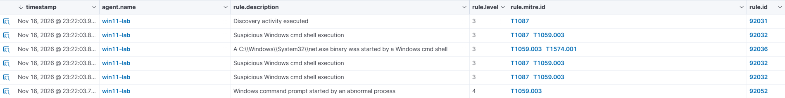
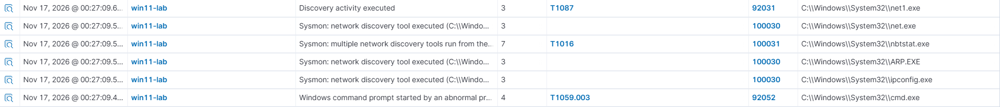

# Custom Detection Rules

## T1016 System Network Configuration Discovery
```xml
<group name="windows,sysmon,">
  <!-- base rule checking for commands related to T1016 -->
  <rule id="100030" level="3">
    <if_sid>61603,92031,92032,92036</if_sid>
    <field name="win.eventdata.image" type="pcre2">(?i)\\(arp|nbtstat|net|ipconfig|netsh)\.exe$</field>
    <description>Sysmon: network discovery tool executed ($(win.eventdata.image))</description>
  </rule>

  <!-- detecting several different tools from same parent in short timeframe -->
  <rule id="100031" level="7" frequency="4" timeframe="30">
    <if_matched_sid>100030</if_matched_sid>
    <same_field>win.eventdata.parentProcessGuid</same_field>
    <description>Sysmon: multiple network discovery tools run from the same parent within 30s</description>
    <mitre>
      <id>T1016</id>
    </mitre>
  </rule>
</group>
```

**Rule 100030** detects when any of the following discovery tools (`arp`, `nbtstat`, `net`, `ipconfig`, `netsh`) are run. It relies on Sysmon's process creation event in order to send out an alert for these executables.  

**Rule 100031** is sent out and tagged with MITRE ID T1016 when there are several matches of 100030 that come from the same parent process (`parentProcessGuid`) within 30 seconds.

**Design choice:** Rule 100031 is based off 100030 because one tool run such as `ip config` could be a routine, but when several discovery tools are ran within a short timeframe and especially from the same shell, it should be something worth noting and making a custom alert for. 

I wrote this rule because the alerts sent from Wazuh's default rules produced multiple generic alerts for the T1016 test, like `Suspicious Windows cmd shell execution` and `Discovery activity executed`, which could be easily overlooked. I wanted to make a rule that targeted this type of behavior and sent out a more specific alert that would can help analysts tell someone is looking through their network. 

**Before**
> Before: no alert was tagged with T1016 and the logs seem generic enough that someone might ignore it



**After**
> After: logs are more specific and 100031 is seen and tagged with T1016 after multiple 100030 logs went off  



**Testing:**  

| Test | Expected | Result |
|---|---|---|
| Atomic T1016-1 | An alert with 100031 should be sent | Alert with 100031 was sent along with the T1016 tag |
| Manually run `ipconfig /all` 4 times from the same PowerShell | No alert | 100030 alert for each `ipconfig /all` and 100031 was sent out after several 100030 alert matches (**false positive**) |  

**Issues encountered while making it:**
- Using `<different_field></different_field>` broke rule 100031, while `<same_field></same_field>` worked. I planned to use `<same_field>` to check that several alerts came from the same parent process (`win.eventdata.parentProcessGuid`) while also using `<different_field>` to confirm that each alert came from different executable locations. After testing the rule with only each field at a time, I found out that `<different_field>` caused 100031 to not work properly and removed that from rule 100031.
- `netsh.exe` doesn't produce a 100030 alert when Atomic test T1016-1 (working on figuring out why)

**Limitations:**
