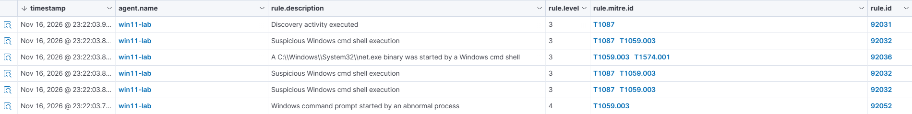
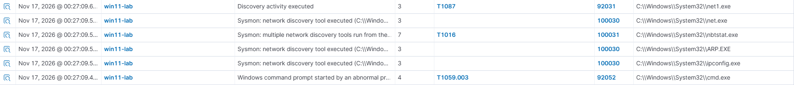

# Custom Detection Rules

## T1016 System Network Configuration Discovery
```xml
<group name="windows,sysmon,">
  <!-- base rule checking for commands related to T1016 -->
  <rule id="100030" level="3">
    <if_sid>61603,92031,92032,92036</if_sid>
    <field name="win.eventdata.image" type="pcre2">(?i)\\(arp|nbtstat|net|ipconfig|netsh)\.exe$</field>
    <description>Sysmon: network discovery tool executed ($(win.eventdata.image))</description>
  </rule>

  <!-- detecting several different tools from same parent in short timeframe -->
  <rule id="100031" level="7" frequency="4" timeframe="30">
    <if_matched_sid>100030</if_matched_sid>
    <same_field>win.eventdata.parentProcessGuid</same_field>
    <description>Sysmon: multiple network discovery tools run from the same parent within 30s</description>
    <mitre>
      <id>T1016</id>
    </mitre>
  </rule>
</group>
```

The rule detects when several discovery commands/tools are ran from the same shell within a certain timeframe (30 seconds). It relies on detecting a process creation log in order to send out an alert with the ID T1016 to signify multiple tools were ran in a short amount of time.   

This rule was made because the alerts sent from Wazuh's default rules sent out multiple generic alerts like `Suspicious Windows cmd shell execution` and `Discovery activity executed`, which could be easily overlooked. I wanted to make a rule that targeted this type of behavior and sent out a more specific alert that would make it more noticeable.  

I tested this custom rule by running the T1016 test 1 in the PowerShell and seeing what ID would appear in Wazuh event dashboard.  
**Before**
  

**After**

